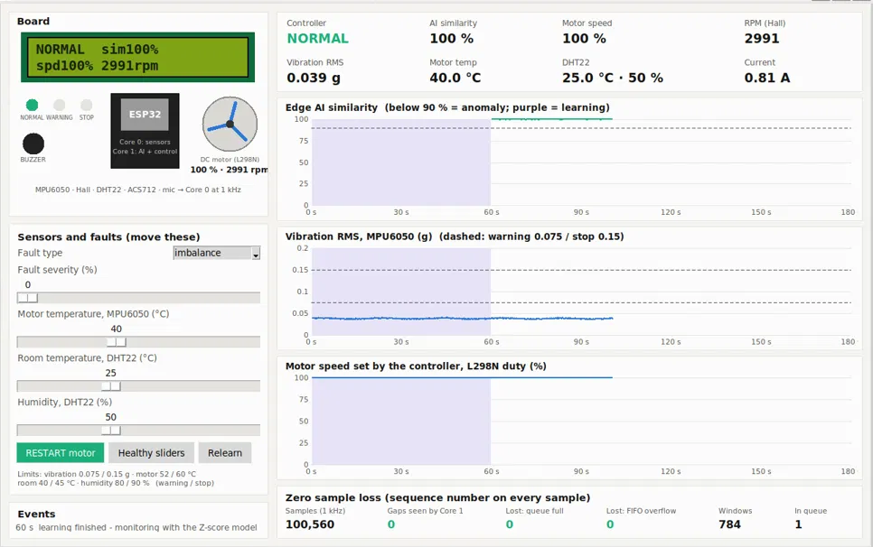
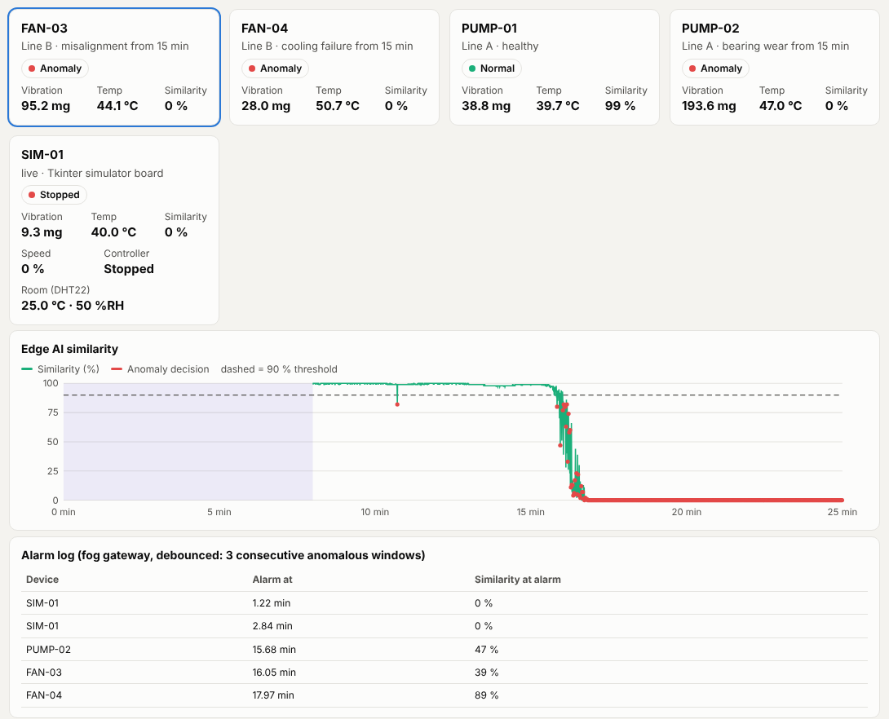

# Dual-Core Real-Time Anomaly Detection with IoT Sensors

Edge AI motor monitoring on a **dual-core ESP32**: Core 0 reads six IoT sensors at 1 kHz without losing a
single sample, Core 1 runs a one-class anomaly model learned on the device and protects the motor
(warn → slow down → stop). A fog tier analyses a whole fleet in parallel with OpenMP, and a live dashboard
and an interactive simulator show everything working end to end. Base paper: Chan et al., *An Edge AI-Based
Anomaly Detection System for Predictive Motor Maintenance*, JCSSE 2026.

| Simulator (virtual ESP32 board) | Live dashboard |
|---|---|
|  |  |

## Key results

| Result | Base paper approach | This project |
|---|---|---|
| Balanced accuracy (mixed faults) | 73.8 % (temperature) | **97.5 %** (vibration), **100 %** (6 sensors) |
| Fault types detected (of 7) | 4 | **7** |
| Bearing fault detected after | 5.3 min | **0.5 min** |
| Samples lost with a heavy model | up to 95 % (one core) | **0 %** (dual core) |
| False alarms under room-temperature drift | 68 / h | **0 / h** |
| Fog speed-up on uneven work (2 threads) | 1.08× (static) | **1.83×** (dynamic) |

All sensors are simulated at register level; the C code, threads, OpenMP kernels and timings are real.
```

## Quick start (Ubuntu / WSL)

```bash
sudo apt install -y gcc python3-venv
python3 -m venv ~/venv && source ~/venv/bin/activate
pip install -r requirements.txt
python run_all.py                 # ~20 min on 2 cores (includes 5 min of real-time zero-loss runs)
python run_all.py --quick         # ~10 min
python ui/fog_server.py           # live dashboard at http://localhost:8060
python tests/test_edge_equivalence.py
'''

## Where each objective is implemented

| Objective | Files | Output |
|---|---|---|
| 1 Expected functionalities | `csrc/mpu6050_sim.c`, `csrc/features.c`, `csrc/detector.c`, `csrc/edge_dualcore.c` | `o1_bearing_timeline.png`, `o1_fault_spectra.png` |
| 2 Architecture justification | `py/exp_architecture.py` | `o2_architecture.json` (ESP32 code size, RAM budget, data rates) |
| 3 Parallelization: edge (TLP) | `csrc/edge_dualcore.c`, `csrc/ringbuf.h`, `py/exp_edge_rt.py` | `o3_edge_dualcore.png/.csv` |
| 3 Parallelization: fog/cloud (TLP, schedule, chunk, DLP, ILP) | `csrc/fleet_omp.c`, `py/exp_fleet.py` | `o3_fleet_*.png/.csv`, `o3_dlp_ilp.png` |
| 3 UI, edge/fog/cloud split | `ui/fog_server.py`, `ui/dashboard.html` | dashboard |
| 4 Performance metrics | `py/exp_detection.py`, `py/methods.py` | `o4_detection_*.csv`, `o4_detection_delay.png` |

| Remark | Where | Output |
|---|---|---|
| Z-score model with more than one input (temperature, vibration, humidity, RPM, sound, current) | `csrc/ms_core.c` (sensors + 18 features), `py/exp_ms_sensors.py` | `r1_sensor_sets.csv`, `r1_sensor_heatmap.png` |
| Zero sample loss and how to measure it | `csrc/edge_ms.c` (sequence numbers, 5 loss counters, store-and-forward), `py/exp_zeroloss.py` | `r2_zero_loss.csv` |
| AI/GenAI, self-optimising | `det_adapt` in `csrc/detector.c`, `py/exp_selfopt.py` | `r3_selfopt_drift.png`, `r3_maintenance_reports.md` |
| Sample project (MPU6050, Hall, DHT, L298N, ESP32) | `ms_ctrl_step` in `csrc/ms_core.c`, `py/exp_ms_control.py`, `esp32/sample_project/` | `r6_control_*.png/.csv` |
| AI vision, engine-sound case study | write-up only | proposed-work document |

Real ESP32 nodes post to `python ui/fog_server.py --ingest`, which checks for missing windows and samples.

## Simulator (Tkinter window)

`simulator/` holds a desktop simulator of the sample project. It runs the same dual-core edge C code
as the ESP32 firmware, with sliders for the faults and sensors, an LCD, LEDs, a buzzer, a motor, live
charts and the zero-loss counters. Run it with `python3 simulator/board_tk.py --speed 2`. See
`simulator/README.md`.

## Layout

```
config.py                constants (1 kHz, 256-sample windows, 90 % threshold, ...)
run_all.py               runs everything, writes results/RESULTS.md
csrc/mpu6050_sim.*       MPU6050 registers + motor model with 5 fault types
csrc/features.*          31 features, radix-2 FFT, envelope spectrum
csrc/detector.*          ZSM and Mahalanobis detectors with on-device learning
csrc/ringbuf.h           lock-free Core 0 -> Core 1 queue
csrc/edge_dualcore.c     edge node: 2 pinned threads (or --mode single)
csrc/fleet_omp.c         OpenMP fog/cloud program with internal sweeps
csrc/ms_core.*           sample project: motor + 6 sensors, 18 features, protection controller
csrc/edge_ms.c           sample-project edge node with zero-loss accounting
esp32/sample_project/    Arduino sketch for the real build
simulator/               Tkinter simulator of the sample project (dual-core edge code)
csrc/sim_api.c           functions exported to Python
py/                      experiments, detectors comparison, report
ui/                      fog gateway server + dashboard
tests/                   streaming edge == batch evaluation
```

## Honest notes

- All sensor data are simulated. The fault signatures (1x, 2x, BPFO impacts, harmonics, heat)
  follow standard vibration-analysis behaviour, but they are not recordings from a real motor.
- The dual-core timing runs on a PC. Processing time per window is swept (`--proc-us`) to stand in
  for a slower MCU or a heavier model; the I2C time is computed from the bus speed.
- Thresholds are chosen on calibration sessions and reported on separate test sessions.
